# AGony

**A desktop environment that lives in a terminal** — for people who hate
terminals but want to learn to like them, and for people whose memory
for commands is short.

AGony is a [Rust](https://rustlang.org) TUI built on
[ratatui](https://github.com/ratatui/ratatui) (`=0.29.0`, pinned by
`ratatui-rmux`), hosted on the [rmux](https://crates.io/crates/rmux-sdk)
multiplexer engine: AGony never touches a ConPTY itself — it asks the
rmux daemon for a pane, and the daemon owns the process tree. On top of
that engine AGony adds the desktop: a taskbar, a start menu, a window
manager, a file panel, a command bar that suggests everything, themes,
and an app directory that installs terminal apps for you.

Windows-first; cross-platform is a goal. Licensed under the
[Annoying Goods Open Source License with Ethical Restrictions](LICENSE).

## The tour

The desktop: windows with chrome over a docked file panel and a taskbar
with a clock — plus the first-run welcome naming the three things to try
(the start menu, the command bar, the file panel), reopenable any time
from **menu ▸ SETTINGS ▸ About AGony**.



The command bar (`Ctrl-K`): type `git che` and carapace-bin completes
`checkout` — suggestions merge the app catalog, the run history and the
file panel with carapace's; only `Enter` runs anything.


Grab a file in the panel (`g`), drop it into the bar (`Ctrl-G`): the
paste menu shows the exact text each form inserts — name, absolute
path, or relative to the bar's cwd.



## Install

Build from source; on Windows (the first-class platform) the rmux engine
and the completion binary are acquired on the way:

```powershell
git clone https://github.com/mrmflis-hub/AGony
cd AGony
cargo build
powershell -ExecutionPolicy Bypass -File scripts/get-carapace.ps1   # hash-checked download into bin/
cargo run -p agony -- doctor                                        # reports the environment; never repairs
cargo run -p agony                                                  # the desktop
```

**The completion binary matters**: without carapace the command bar's
completions are gone (everything else works). `agony doctor` says so in
its first lines if it is missing. On Linux/macOS install `carapace-bin`
your own way and point `AGONY_CARAPACE` at it — acquisition is scripted,
never vendored.

On Linux and macOS the same five lines work with your shell's `cargo`
and the engine's Unix socket — AGony's platform code sits behind one
seam (`crates/agony/src/platform.rs`), CI runs the full landing
checklist on all three platforms, and `scripts/dist.sh` packages a
release archive wherever it runs. 

First run starts a self-healing rmux daemon, lands `THANK-YOU.md` (every
dependency, credited) on the AGony desktop, and opens the welcome
document. Everything lives under `%APPDATA%\agony\` (or
`$XDG_CONFIG_HOME/agony`, falling back to `~/.config/agony`).

## The app directory and the bundled set

The start menu's **PROGRAMS ▸ Get more apps…** opens the directory: a
curated catalog (`catalog/terminal-apps.toml`, seeded from the
awesome-terminal and awesome-tui lists, licenses verified by hand)
grouped installed / available / GPL shelf. `Enter` on an entry asks
once — the exact command shows before it runs — then installs through
its recipes (winget, then scoop, then cargo/go, or a hash-checked
release download into `%APPDATA%\agony\bin`).

From the command line:

```text
agony apps list                          # the effective catalog, with install state
agony apps bundle                        # the bundled set
agony apps bundle --install gambit       # download, verify sha256, install
agony apps install bat                   # any catalog app through its recipes
agony apps add --id mytool --name MyTool --exec mytool
```

Copyleft apps are never bundled or embedded — they ship as catalog
entries with their license in the open and install through their own
recipes like anything else. The validator refuses a `bundled` manifest
with a GPL license; that rule is a test, not a promise.

## Development

```text
cargo test --workspace --all-targets     # the atomic build
cargo clippy --workspace --all-targets && cargo fmt --all --check
cargo run -p agony -- selftest           # the gate: real daemon, real pane, PASS required
python scripts/demo_cast.py --help       # re-record the demos (ConPTY + asciicast)
vhs demo/desktop.tape                    # or rerun a tape with vhs (ttyd + ffmpeg)
```

## Credits

Every dependency, with its license, is credited where the user can see
it: `agony thanks` generates `THANK-YOU.md` onto the AGony desktop (the
tables above are that generator's output at build time). Standing
credits: **rmux / rmux-sdk / ratatui-rmux** (the engine), **
carapace-bin** (completions and the candidate catalog), and the early
demos that proved a desktop could live in a terminal.
